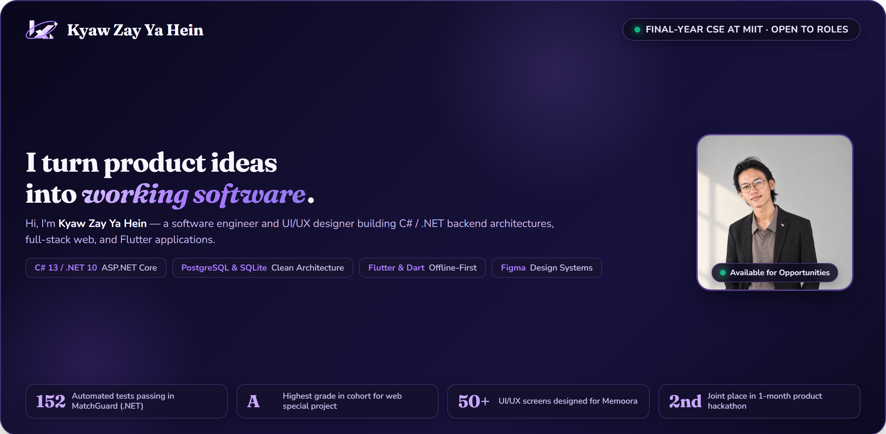
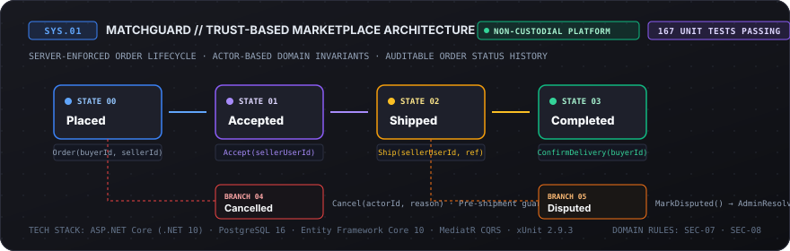
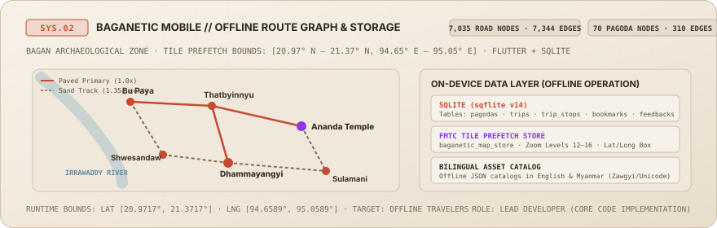
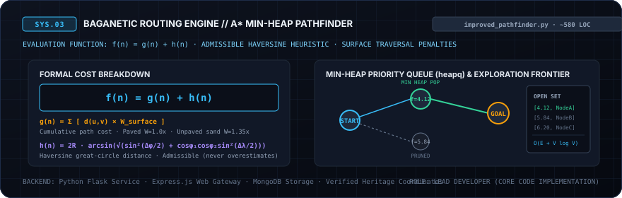
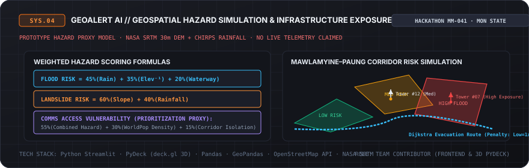

<!-- 01 / IDENTITY MASTHEAD -->
<p align="center">
  <a href="https://swordsouloflabrynth.github.io/portfolio/">
    <picture>
      <source media="(prefers-color-scheme: dark)" srcset="assets/kzyh-portfolio-banner-dark.png">
      <source media="(prefers-color-scheme: light)" srcset="assets/kzyh-portfolio-banner-light.png">
      
    </picture>
  </a>
</p>

<div align="center">

# Kyaw Zay Ya Hein
### Software Engineer & UI/UX Designer

`[FINAL-YEAR CSE @ MIIT · EXPECTED 2027]` · `[MANDALAY, MYANMAR]` · `[OPEN TO ROLES]`

[](https://swordsouloflabrynth.github.io/portfolio/)
[](https://linkedin.com/in/kyaw-zay-ya-hein-00aba927b)
[](mailto:kyawzayyahein.mdy@gmail.com)
[](https://swordsouloflabrynth.github.io/portfolio/assets/documents/Kyaw_Zay_Ya_Hein_CV_Resume.pdf)

<br/>

> **"I turn product ideas into working software."**  
> Final-year Computer Science & Engineering student at Myanmar Institute of Information Technology (MIIT, graduating 2027). Building maintainable C# / .NET backend architectures, offline-first Flutter mobile applications, and developer-grade product design systems.

</div>

---

## 02 / Engineering Philosophy & Focus

I approach software engineering with a product builder's perspective: decomposing ambiguous requirements into rigorous domain models, crafting resilient transactional backends, and building offline-capable client applications with elevated UI/UX standards.

Rather than chasing superficial complexity or decorative boilerplate, I prioritize architectural clarity, verifiable data integrity, and empirical proof.

---

## 03 / Featured System: MatchGuard

### MatchGuard — Trust-Based Marketplace Architecture
**Role**: Sole Developer · **Context**: Independent Architecture Project  
**Repository**: [`SwordsoulOfLabrynth/TrustedMarketplace`](https://github.com/SwordsoulOfLabrynth/TrustedMarketplace)

<p align="center">
  
</p>

#### Problem Space
Peer-to-peer digital commerce requires verifiable trust, clear dispute boundaries, and strict order fulfillment guarantees—without the legal, operational, and regulatory exposure of holding money, custodying funds, or acting as a payment intermediary.

#### Architectural Decisions
- **Non-Custodial Marketplace Architecture**: The platform does **not** hold, route, custody, or automatically settle buyer or seller funds. Instead, it enforces a deterministic transaction lifecycle and state verification engine that governs formal order progression between participants.
- **Deterministic Domain State Machine**: Modeled order progression as a finite-state aggregate with explicit domain status enumerations: `Placed` (0) → `Accepted` (1) → `Shipped` (2) → `Completed` (3), with guarded branching for `Cancelled` (4) and `Disputed` (5).
- **Actor Authorization & Domain Invariants**: State transition methods encapsulate domain invariant checks (`DomainException`):
  - Only the assigned seller can accept an order (`Accept(sellerUserId)`) or record dispatch with a courier tracking reference (`Ship(sellerUserId, trackingRef)`).
  - **SEC-07 & SEC-08 Buyer-Confirmed Delivery**: Only the verified buyer who placed the order can confirm receipt and transition status to `Completed` (`ConfirmDelivery(buyerUserId)`). Status transitions represent fulfillment milestones, not financial releases.
  - Buyer cancellations are restricted to `Placed` status; seller cancellations cannot occur once shipped (`Cancel(actorUserId, reason)`).
- **Dispute Handling & Administrative Resolution**: Both buyer and seller can transition an active order to `Disputed` prior to completion (`MarkDisputed(actorUserId, reason)`); administrative arbitration writes an explicit audit entry resolving the state to either `Completed` or `Cancelled` (`AdminResolveDispute(adminUserId, resolvedStatus, reason)`).
- **Auditable Status History**: Every state transition automatically appends to an internal `OrderStatusHistory` collection, capturing the actor ID, timestamp, previous status, new status, and justification reason.
- **In-Process CQRS via MediatR**: Segregated read queries from transactional command mutations, executing through validation and logging pipeline behaviors.
- **Data Integrity & Security**: PostgreSQL 16 managed via Entity Framework Core 10 migrations, ASP.NET Core Identity PBKDF2 password hashing, and stateless JWT claim tokens.
- **Containerization**: Configured `postgres:16-alpine` via `docker-compose.yml` and authored multi-stage production Dockerfiles.

#### Verified Engineering Evidence
- **167 Automated Unit Tests Passing Locally**: Executed via xUnit 2.9.3 (`dotnet test tests/TrustedMarketplace.UnitTests/TrustedMarketplace.UnitTests.csproj` in 1.0s) verifying domain invariants, aggregate state transitions, seller/buyer actor guards, and validation handlers.
- **87 Integration Test Methods Implemented**: Authored in `TrustedMarketplace.IntegrationTests` with `PostgreSqlFixture` database resets (unexecuted locally; require an active PostgreSQL container).
- **CI Configuration**: Continuous Integration pipeline defined in `.github/workflows/ci.yml` (remote execution unverified).

---

## 04 / Selected Systems

### 1. Baganetic Mobile — Offline-First Product Engineering
**Role**: Lead Developer · **Context**: University Team Project (4-Person Team)  
**Repository**: [`SwordsoulOfLabrynth/BaganeticMobileApp`](https://github.com/SwordsoulOfLabrynth/BaganeticMobileApp)

<p align="center">
  
</p>

*Independently handled nearly all software implementation, while collaborating with teammates on requirements, documentation, and validation.*

- **Network-Independent Navigation**: Engineered an on-device routing engine that parses bundled spatial network data:
  - `offline_graph.json`: Bundled road network graph comprising **7,035 road nodes and 7,344 edges** across the Bagan archaeological zone.
  - `pagoda_route_graph.json`: Clustered pagoda transit backbone comprising **70 monument waypoint nodes and 310 topological edges**.
- **Map Tile Architecture**: Integrated `flutter_map_tile_caching` (FMTC) configured for the Bagan archaeological zone coordinate bounds (Center: 21.1717° N, 94.8589° E; Bounding Box: 20.9717° N – 21.3717° N, 94.6589° E – 95.0589° E, zoom levels 12–16). *(FMTC prefetch store integrated in codebase; runtime offline tile persistence marked as not independently tested).*
- **On-Device Local Persistence**: Built SQLite schemas (`sqflite`, version 14) supporting offline itineraries, custom trip stops, pagoda bookmarks, road condition reports, and bilingual localization (English / Myanmar).

---

### 2. Baganetic Routing Engine — Algorithms & Geospatial Systems
**Role**: Lead Developer · **Context**: MIIT Special Project (Four-Person Academic Project)  
**Repository**: [`SwordsoulOfLabrynth/Baganetic`](https://github.com/SwordsoulOfLabrynth/Baganetic)

<p align="center">
  
</p>

*Independently handled nearly all software implementation, while collaborating with teammates on requirements, documentation, and validation.*

- **Custom A\* Pathfinding Algorithm**: Engineered `improved_pathfinder.py` (~580 lines) using Python's min-heap priority queue (`heapq`).
- **Mathematical Heuristics**: Formulated cost function `f(n) = g(n) + h(n)`, combining Haversine great-circle distance `h(n)` with surface-weighted traversal costs (`g(n)`, e.g., 1.35x penalty for unpaved dirt tracks).
- **Hybrid System Stack**: Paired the Python Flask algorithmic service with a Node.js Express web portal and MongoDB document store.
- **Verification**: Route reconstruction and node-expansion pruning verified against physical Bagan coordinates.

---

### 3. GeoAlert AI — Geospatial Hazard Simulation
**Role**: Team Contributor · **Context**: Hackathon Project (`HACK-MM-041`)  
**Repository**: [`SwordsoulOfLabrynth/GeoAlert-AI-HACK-MM-041`](https://github.com/SwordsoulOfLabrynth/GeoAlert-AI-HACK-MM-041)

<p align="center">
  
</p>

*Contributed to Streamlit frontend development, PyDeck 3D visualization layers, and data integration.*

- **Topographic Hazard Modeling**: Visualized simulated 100-year flood zone polygons and landslide slope contours across the Mawlamyine–Paung corridor in Mon State using NASA SRTM 30m DEM, CHIRPS v2.0 rainfall, and OpenStreetMap waterways.
- **Infrastructure Exposure Proxy**: Formulated composite hazard vulnerability scores (Flood: 45% rain + 35% inverse elevation + 20% waterway; Landslide: 60% slope + 40% rain) to assess telecommunications tower exposure. *(Simulated prototype proxy model; does not measure live mobile tower telemetry or active emergency road closures).*
- **3D Visualization & Evacuation Routing**: Rendered interactive column and polygon overlays using PyDeck (`deck.gl`) and implemented risk-weighted Dijkstra evacuation routing (penalties: low=1x, medium=2x, high=5x) to bypass high-hazard segments.

---

## 05 / Engineering Practice

My engineering workflow balances product intuition with technical rigor and modern tooling:

```
[01. SPECIFY]          Translate product ideas into requirements, domain rules & data structures
       │
[02. ARCHITECT]        Define modular boundaries, workflows & system behavior
       │
[03. ACCELERATE]       Use AI coding assistants for implementation scaffolding & iteration
       │
[04. INSPECT & REFINE] Review generated code, investigate edge cases, debug & improve implementation
       │
[05. TEST & VERIFY]    Define test requirements, inspect test logic, execute tests & validate behavior
       │
[06. PACKAGE]          Organize projects, manage migrations, configure environments & document architecture
```

> **Transparent Engineering Disclosure**: I define product specifications, domain models, and test requirements, utilizing AI coding assistants for implementation scaffolding and iteration while personally inspecting, debugging, and validating all software logic. In team projects, I take ownership of core software implementation while collaborating with peers on requirements, documentation, and validation.

---

## 06 / Technical Toolkit

A focused inventory of technologies grounded strictly in verified repository codebases:

```
LANGUAGES           C# · Dart · Python · TypeScript · SQL · JavaScript
BACKEND & APIS      ASP.NET Core (.NET 10) · MediatR (CQRS) · Flask · Node.js / Express
DATA & STORAGE      PostgreSQL 16 · Entity Framework Core 10 · SQLite · MongoDB
MOBILE & CLIENT     Flutter · Provider · Tailwind CSS · React · Streamlit
ENGINEERING RIGOR   xUnit (167 passing unit tests) · Moq · Docker · Git · Postman · Figma
ACADEMIC EXPOSURE   Java · C (Core MIIT Coursework)
```

---

## 07 / Colophon

```
BUILD WITH INTENT. TEST WITH EVIDENCE. KEEP EXPLORING.
```

[Portfolio](https://swordsouloflabrynth.github.io/portfolio/) · [LinkedIn](https://linkedin.com/in/kyaw-zay-ya-hein-00aba927b) · [GitHub Profile](https://github.com/SwordsoulOfLabrynth)
