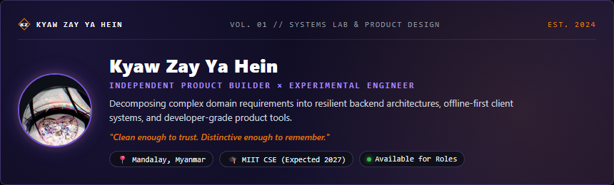
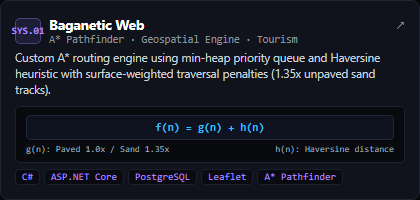
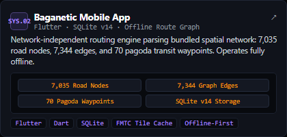
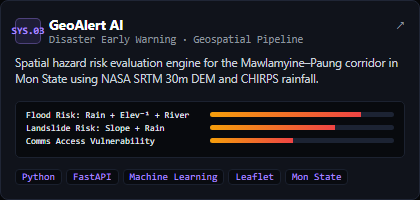
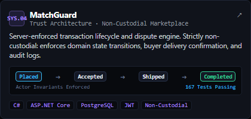
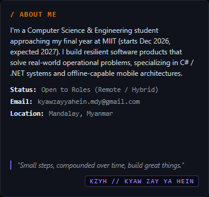
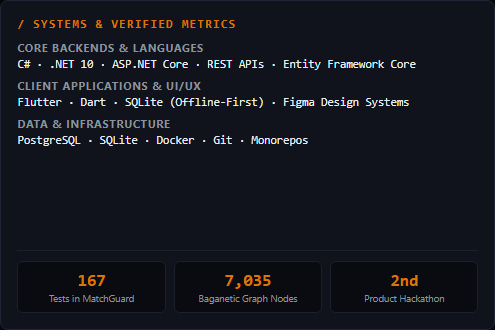

  

<table>
  <tr>
    <td width="70%" align="left">
      <h3 style="display: inline; font-family: ui-monospace, SFMono-Regular, Consolas, monospace; color: #D97706; font-size: 13px; letter-spacing: 1.5px;">/ FEATURED SYSTEMS &amp; ARCHITECTURES</h3>
    </td>
    <td width="30%" align="right">
      <a href="https://github.com/SwordsoulOfLabrynth?tab=repositories">View all repositories ↗</a>
    </td>
  </tr>
</table>

<table>
  <tr>
    <td width="50%" valign="top">
      
    </td>
    <td width="50%" valign="top">
      
    </td>
  </tr>
  <tr>
    <td width="50%" valign="top">
      
    </td>
    <td width="50%" valign="top">
      
    </td>
  </tr>
</table>

  

<table>
  <tr>
    <td width="41%" valign="top">
      
    </td>
    <td width="59%" valign="top">
      
    </td>
  </tr>
</table>

 

  <h4 style="font-family: ui-monospace, SFMono-Regular, Consolas, monospace; letter-spacing: 2px; font-size: 12px; margin-bottom: 6px; color: #A98AFF;">BUILD WITH INTENT. TEST WITH EVIDENCE. KEEP EXPLORING.</h4>
  

    <strong>Kyaw Zay Ya Hein</strong> · MIIT Computer Science &amp; Engineering '27 
    <a href="https://swordsouloflabrynth.github.io/portfolio/">Portfolio</a> · 
    <a href="https://linkedin.com/in/kyaw-zay-ya-hein-00aba927b">LinkedIn</a> · 
    <a href="mailto:kyawzayyahein.mdy@gmail.com">Email</a> · 
    <a href="https://github.com/SwordsoulOfLabrynth">GitHub Profile</a>
  

